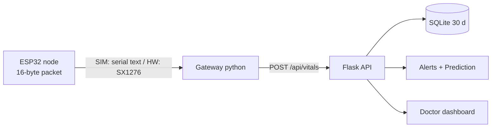

# Remote Patient Monitoring — ESP32 + LoRa + Raspberry Pi + Prediction API

Implementation of the report *"ESP32–LoRa–Raspberry Pi Remote Patient Monitoring System with Prediction API"* (Oct 8 2026, **Pre-MVP**: the report has no measurements; its numbers are targets).
**Research prototype. Not a medical device. Synthetic data is not patient data. Alert thresholds and risk levels are unvalidated.**

## 1. What is real, simulated, hardware-only
See `docs/simulation_limits.md` (summary) and `docs/requirements_traceability.md` (report -> code). Short version: DS18B20/MPU6050/LED/buzzer are in the Wokwi circuit; **MAX30102 is synthetic**; **LoRa is hardware-only** — the Wokwi→gateway path is a serial-text *simulation*, not LoRa. Gateway, API, SQLite, alerts, prediction (linear-regression fallback), dashboard run on any computer. No LSTM is trained. All performance targets are **Not tested** (`docs/validation_plan.md`).

## 2. Architecture

Details: `docs/architecture.md`. Packet layout: `gateway/telemetry.py` docstring.

## 3. Directory tree
```
├── README.md  requirements.txt  .env.example  .gitignore
├── wokwi/patient_node/        diagram.json patient_node.ino telemetry.h fall_detector.h patient_reading.h libraries.txt README.md
├── wokwi/gateway_simulation/  gateway_simulator.py simulated_patients.py README.md
├── gateway/   app.py config.py database.py telemetry.py alerts.py prediction.py auth.py radio.py bridge.py maintenance.py README.md
├── dashboard/ templates/index.html  static/style.css  static/app.js
├── ml/        train_model.py evaluate_model.py README.md
├── tests/     test_*.py conftest.py firmware_host/ (C++ cross-check + Arduino stubs)
└── docs/      architecture wiring simulation_limits hardware_deployment validation_plan requirements_traceability
```
(`radio.py`, `bridge.py`, `maintenance.py`, `requirements_traceability.md`, `test_pipeline.py`, `test_firmware_host.py` were added to the suggested layout.)

## 4. Prerequisites
Python 3.10+ (tested on 3.12), pip, a browser. Optional: g++ (firmware host tests), Node (JS syntax check only), a Wokwi account (free) for the node simulation.

### Install — Linux/macOS
```bash
python3 -m venv .venv && . .venv/bin/activate
pip install -r requirements.txt
cp .env.example .env     # then edit tokens
```
### Install — Windows (PowerShell)
```powershell
py -m venv .venv; .\.venv\Scripts\Activate.ps1
pip install -r requirements.txt
Copy-Item .env.example .env   # then edit tokens
```
Generate tokens: `python -c "import secrets; print(secrets.token_urlsafe(32))"`. The app **refuses to start** without `DOCTOR_TOKEN` and `ADMIN_TOKEN`.

## 5. Run the software (no Wokwi needed)
Terminal 1 — API + dashboard (demo mode disables the 30 s per-patient throttle; **omit `VITALS_MIN_INTERVAL_S` in production**):
```bash
# Linux/macOS
export DOCTOR_TOKEN=demo-doctor ADMIN_TOKEN=demo-admin VITALS_MIN_INTERVAL_S=0
python -m gateway.app
```
```powershell
# Windows
$env:DOCTOR_TOKEN="demo-doctor"; $env:ADMIN_TOKEN="demo-admin"; $env:VITALS_MIN_INTERVAL_S="0"
python -m gateway.app
```
The SQLite file (`data/rpm.sqlite3`) is created automatically on first start; an existing DB is never overwritten (set `DB_PATH` to use another file). Initialize/inspect only: `python -c "from gateway.database import Database; Database('data/rpm.sqlite3').init()"`.

Terminal 2 — feed synthetic scenarios through the gateway simulator (same variables set; `API_URL` defaults to `http://127.0.0.1:5000`):
```bash
cd wokwi/gateway_simulation
python gateway_simulator.py --generate NORMAL    --pid P001 --count 15
python gateway_simulator.py --generate LOW_SPO2  --pid P002 --count 3
python gateway_simulator.py --generate HIGH_HR   --pid P003 --count 3
python gateway_simulator.py --generate HIGH_TEMP --pid P004 --count 3
python gateway_simulator.py --generate FALL      --pid P005 --count 3
python gateway_simulator.py --generate SENSOR_ERROR --pid P006 --count 3
```
(`--generate` back-dates timestamps 60 s apart ending now so history/prediction have a time axis; data stays flagged SYNTHETIC.)

**Dashboard:** open http://127.0.0.1:5000 → paste the doctor token → Connect. (Token is typed by you, kept in `sessionStorage`, never embedded in the page.)

## 6. API usage
```bash
H="Authorization: Bearer demo-doctor"
curl localhost:5000/api/health
curl -X POST localhost:5000/api/vitals -H "$H" -H "Content-Type: application/json" \
     -d '{"pid":"P001","hr":78,"spo2":97,"temp":36.7,"fall":0,"ts":'$(date +%s)'}'
curl -H "$H" localhost:5000/api/patients
curl -H "$H" localhost:5000/api/patient/P001/latest
curl -H "$H" "localhost:5000/api/patient/P001/history?hours=24"
curl -H "$H" "localhost:5000/api/patient/P001/predict?horizon=15"
curl -H "$H" localhost:5000/api/alerts            # ?status=acknowledged|all  ?pid=P002
curl -X POST -H "$H" localhost:5000/api/alerts/1/ack
curl -X POST -H "Authorization: Bearer demo-admin" localhost:5000/api/model/retrain -H "Content-Type: application/json" -d '{"action":"reload"}'
```
Authentication: `Authorization: Bearer <token>`. Doctor token for all endpoints except `/api/health`; **admin token only** for `/api/model/retrain`. Errors: `{"error":"msg","code":"E_XXX"}` (400/401/404/429/501/500). `POST /api/vitals` also accepts optional `seq`, `uptime`, `flags`, `synthetic`, `source`; `hr/spo2/temp` may be `null` only when the matching fault bit is set in `flags` (4 = HR/SpO2, 8 = temp).
Differences from the report: extra `GET /api/patients`; `/api/model/retrain` returns **501** (retraining is offline, `ml/train_model.py`) unless `{"action":"reload"}`; only horizon 15 is allowed by default (`ALLOWED_HORIZONS`).

## 7. Run the patient node in Wokwi or on an ESP32

The Wokwi project is already configured in this repository: root `diagram.json` describes the ESP32-S3 DevKitC-1 circuit, and `wokwi.toml` points to the compiled firmware under `wokwi/patient_node/build/`. The circuit has a Wokwi DS18B20 and MPU6050, one red LED, and a buzzer. HR and SpO2 use deterministic software profiles; the `FALL` command is a one-record test event, not a real fall measurement. GPIO assignments are listed in `docs/wiring.md`.

### Build and start the local Wokwi simulation (Windows)

From the repository root in PowerShell:

```powershell
# Arduino CLI bundled with Arduino IDE on this machine, if it is not already on PATH:
$env:Path = "$env:LOCALAPPDATA\Programs\Arduino IDE\resources\app\lib\backend\resources;$env:Path"
.\scripts\build_esp32_wokwi.ps1
```

The build script targets `esp32:esp32:esp32s3` and writes the `.bin` and `.elf` files that `wokwi.toml` expects. It requires the ESP32 Arduino core and the `OneWire` and `DallasTemperature` libraries. If Arduino CLI is installed elsewhere, add its directory to `PATH` instead.

1. Open the repository root (`remote-patient-monitoring`) as the VS Code folder. The installed **Wokwi Simulator** extension reads the root `wokwi.toml` and `diagram.json`.
2. Build before the first run, then press **Ctrl+Shift+P**, choose **Wokwi: Start Simulator**, and start the simulation. If prompted, complete the extension's Wokwi license/trial setup.
3. Open the Wokwi simulation's **Serial Monitor** and set its baud rate to **115200**. It prints a patient JSON record every **5 seconds** by default. `timestamp_ms` is elapsed milliseconds since boot (not wall-clock time); source fields distinguish synthetic values and unavailable sensors. `DBG {...}` and `LORA_TX_SIM ...` are diagnostic/serial simulations, not LoRa.
4. Enter each command in the Serial Monitor's input and press **Enter**. Commands are case-insensitive; profile changes apply to the next patient reading:

   | Command | Expected patient record / alert behavior |
   |---|---|
   | `help` | Lists available commands. |
   | `normal` | 78 BPM and 98% SpO2; with valid sensors the red LED gives its brief heartbeat flash and the buzzer is silent. |
   | `warning` | 105 BPM and 94% SpO2; these values are below the configured alert thresholds, so the normal LED heartbeat/buzzer-silent behavior remains. |
   | `critical` | 135 BPM and 88% SpO2; the red LED stays on and the buzzer gives a short alert beep every 5 seconds. |
   | `fall` | The next patient record reports `fall_status: "YES"` once; the red LED stays on and the buzzer beeps at 2.5 Hz for the fall alert. This software test does not validate physical fall detection. |

The single red LED is on GPIO5; the buzzer is on GPIO6. A missing/invalid sensor can also raise an alert, so check the record's source fields if the indicators do not match the selected profile. `TEMP_SOURCE SYNTH` selects the profile's simulated temperature (36.6/37.5/38.9 C); the default temperature source is the simulated DS18B20.

To change the reading interval, enter `SET_SAMPLE_INTERVAL 60` (valid range 1–3600 seconds); the default development interval is 5 seconds. This is separate from the telemetry simulation interval, changed with `SET_INTERVAL 10`. No gateway or LoRa radio is needed to view patient readings.

To control the simulation from VS Code, use the Command Palette (`Ctrl+Shift+P`): **Wokwi: Pause Simulation** pauses it, **Wokwi: Resume Simulation** continues it, and **Wokwi: Restart Simulation** restarts the ESP32 from startup. These are the commands contributed by the installed Wokwi Simulator extension; it does not provide a separate stop command.

### Use a physical ESP32 instead

Connect the ESP32-S3 by USB, then find its port with:

```powershell
arduino-cli board list
```

Replace `COM3` below with the port shown (for example, `COM5`):

```powershell
arduino-cli upload --port COM3 --fqbn esp32:esp32:esp32s3 wokwi/patient_node
arduino-cli monitor --port COM3 --config baudrate=115200
```

The monitor accepts the same serial commands. Close the monitor before disconnecting or reusing the port. No physical COM port was present during the last check in this environment.

## 8. Tests
```bash
python -m pytest -q            # all (Windows: same command)
python -m pytest tests/test_api.py -q
```
Firmware tests need g++ (skipped otherwise). Tests use temporary databases and a fake clock.

## 9. Deploy on Raspberry Pi / real hardware
`docs/hardware_deployment.md` (systemd, cron retention, backup, HTTPS caveat, how to attach the real SX1276 and replace the synthetic MAX30102), `docs/wiring.md` (all pins, hardware-only ones separated).

## 10. Retention
`python -m gateway.maintenance` exports readings older than 30 days to `EXPORT_DIR/readings_before_<ts>.csv`, verifies the row count, then deletes them. Schedule nightly (cron / Task Scheduler).

## 11. Known limitations / troubleshooting
* Not clinically validated; thresholds (SpO2<92, HR>120/<40, T≥38/<35, stale>180 s) are prototype defaults, since the report defines only prediction risk rules.
* Prediction = linear-regression trend extrapolation on the last 30 samples (min 10 valid, 5-min steps). It is a baseline, not a trained or validated forecast; `status` and `model` fields say so. Needs readings spaced in real time.
* Node has no RTC; the gateway stamps arrival time.
* `/api/vitals` uses the doctor-level token (report defines no gateway credential); Flask's dev server has no TLS.
* Wokwi names unverified; firmware not built with the real ESP32 core here (host syntax check only).
* Troubleshooting: `RuntimeError: DOCTOR_TOKEN and ADMIN_TOKEN must be set`; gateway `api_errors` = wrong `--api`/port; `429` = throttle; dashboard "Error: missing or invalid token" = re-enter token.
