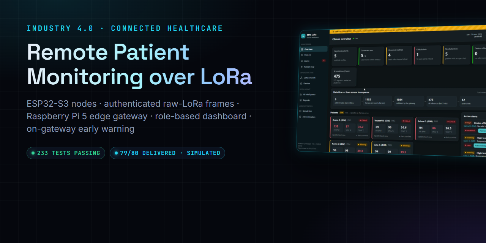
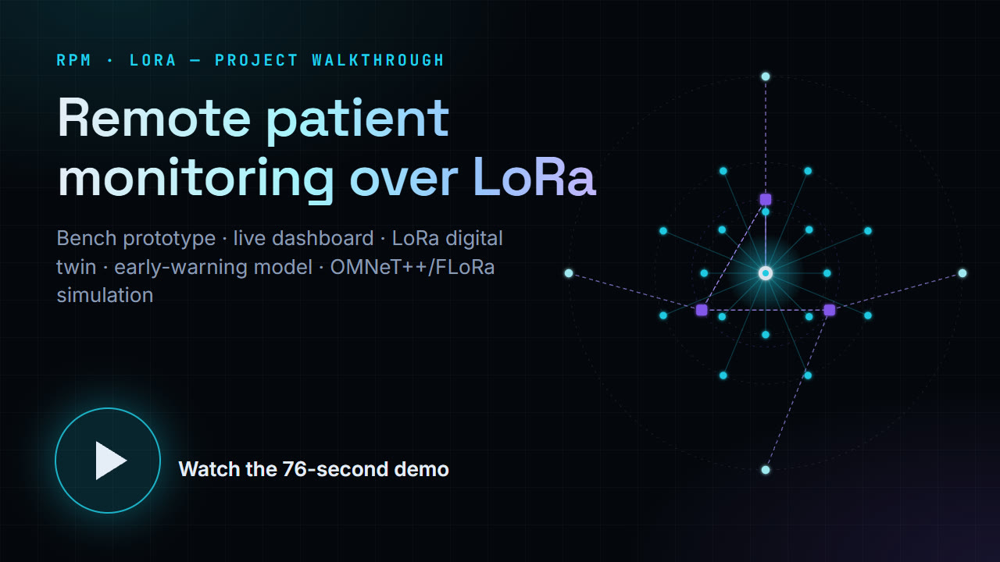
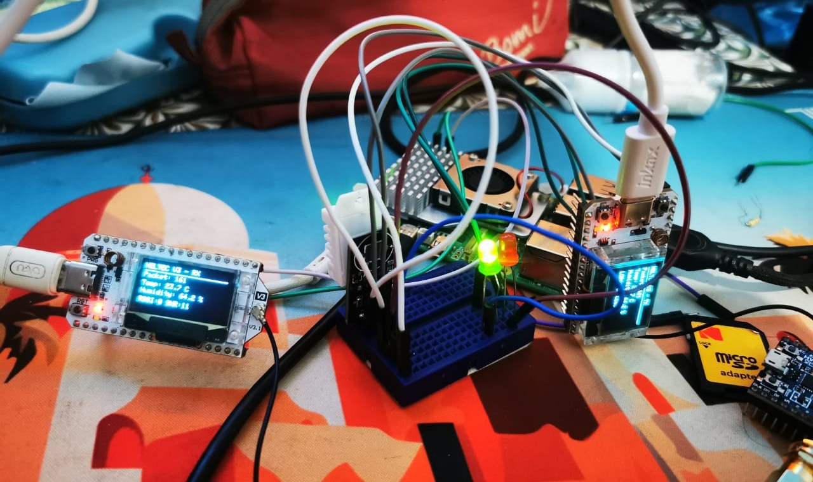
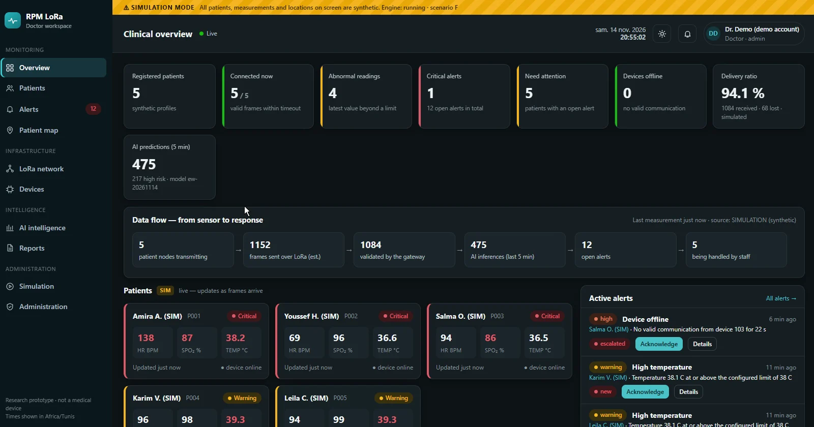
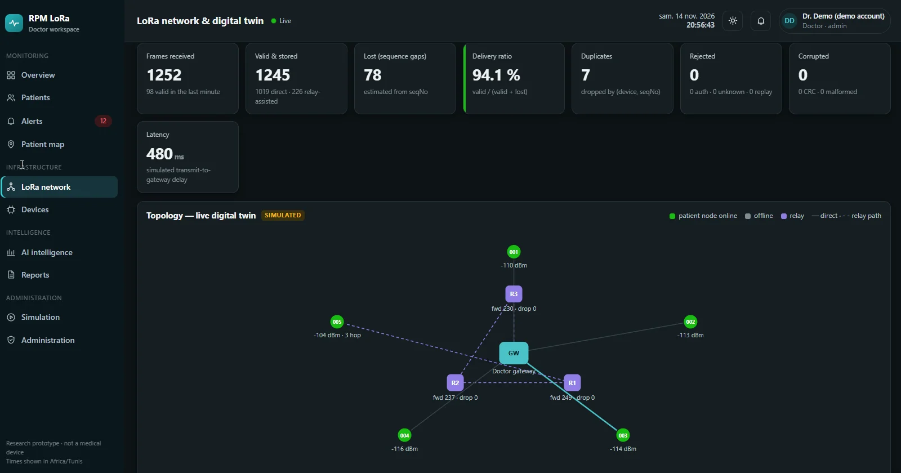
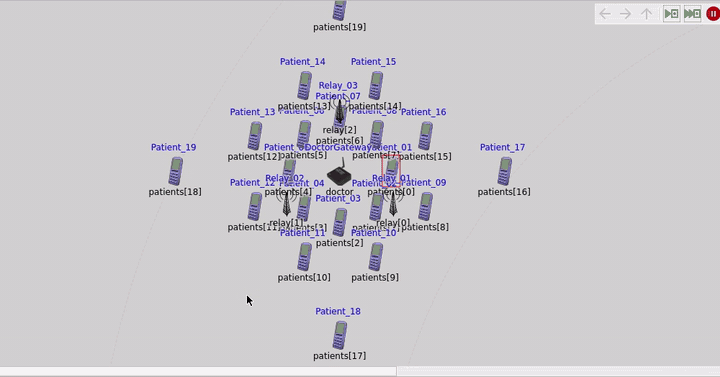

<p align="center"></p>

<h1 align="center">Remote Patient Monitoring over LoRa</h1>

<p align="center"><b>ESP32 bedside nodes · authenticated raw-LoRa frames · Raspberry Pi 5 edge gateway · clinician dashboard · on-gateway early warning</b></p>

<p align="center">


</p>

<p align="center">
<a href="#demonstration">Demo</a> ·
<a href="https://github.com/Iheb1Bekir/RPM_LoRa_Research">Simulation repository</a> ·
<a href="report/main.pdf">Report (PDF)</a> ·
<a href="presentation/RPM_LoRa_presentation.pdf">Presentation (PDF)</a> ·
<a href="docs/">Documentation</a> ·
<a href="#results">Results</a>
</p>

> **Research prototype, not a medical device.** No clinical validation. Alert limits are engineering values, the early-warning model is trained on **synthetic** data, and the physiological sensor node is not assembled yet. Every result below says how it was obtained.

## Demonstration

<a href="site/media/rpm-lora-showcase.mp4"></a>

76-second walkthrough built from real recordings: the bench prototype, the dashboard in simulation mode (all patients synthetic), the LoRa digital twin, the early-warning page and the OMNeT++/FLoRa run. The project website (`site/`) adds an animated replay of the simulated network, an interactive architecture explorer and the results.

## Overview

- **Problem.** Tens of patients whose vital signs change within minutes; frames are tiny, but the link must be low-power, reach through walls and stay trustworthy, because a forged or replayed vital-sign frame is a safety issue.
- **Approach.** A custom raw-LoRa protocol (not LoRaWAN) with a 34-byte frame signed with HMAC-SHA256, application-level relays (up to 4 hops), and a Raspberry Pi 5 gateway that validates, stores, alerts, predicts and serves a role-based web application, offline.
- **Two repositories.** This one holds the physical and software side. [**RPM_LoRa_Research**](https://github.com/Iheb1Bekir/RPM_LoRa_Research) holds the OMNeT++/INET/FLoRa model of the multi-hop network.

### From physical IoT implementation to distributed network simulation

| | [industrie-4.0-lora](https://github.com/Iheb1Bekir/industrie-4.0-lora) (this repository) | [RPM_LoRa_Research](https://github.com/Iheb1Bekir/RPM_LoRa_Research) |
|---|---|---|
| Purpose | firmware, LoRa gateway, web platform, model, report | network modelling and simulation |
| Runs on | ESP32-S3, Raspberry Pi 5, any PC (simulation mode) | OMNeT++ 6.5.0 · INET 4.6.0 · FLoRa 1.3.2 |
| Shared | the same measurement fields (the platform frame adds `payloadType`), SF7 / 125 kHz / 14 dBm, at most 4 hops | |
| Link | the platform imports the simulation's result summary into its LoRa network page | |

They are not yet one deployed end-to-end system: the physiological sensor node and on-site radio tests are pending.

## Physical prototype — hardware implementation



Bench setup: a **Heltec WiFi LoRa 32 V3** receiver (its OLED shows the packet counter, temperature, humidity, RSSI and SNR of received frames), a DHT-type sensor with status LEDs, and a **Raspberry Pi 5** gateway. The bench link carries temperature and humidity; the physiological chain (MAX30102, DS18B20, MPU-6050) is implemented in firmware but not assembled.

| Component | Role | Status |
|---|---|---|
| Heltec WiFi LoRa 32 V3 (ESP32-S3 + SX1262) | bench LoRa receiver, UART bridge (TX on GPIO2) | operating |
| Raspberry Pi 5 | edge gateway (UART0 via `dtoverlay=uart0-pi5`, SPI0) | UART configured, reception to confirm |
| ESP32-S3 patient / relay nodes | sensors, protocol v2, relaying | firmware written, not flashed |
| SX1276/78 or SX1262 | raw LoRa PHY, chosen explicitly per board | pending |

## System architecture

```
ESP32 patient node ──raw LoRa──▶ [relay]* ──▶ SX127x / UART ─ hw_gateway (Pi 5) ─▶ ingestion pipeline ─▶ SQLite (hardware)
   sensors · protocol v2 · HMAC                         store-and-forward        CRC · device auth · replay window
                                                                                 plausibility · alerts · inference
virtual devices (simulation engine) ───────────────── same pipeline ──────────▶ SQLite (simulation, separate file)
                                                                                 │
                                                 REST API v1 + SSE ─▶ web app (doctor · assistant · caregiver)
```

- **Frame v2 (34 B):** identity and routing, 32-bit sequence number, timestamp, HR, SpO₂, temperature, flags, alert level, hop counters, battery, a 64-bit HMAC-SHA256 tag and a CRC-16. Relays may change only `hopCount`, which is outside the tag.
- **Airtime:** 77.1 ms at SF7 / 125 kHz / CR 4/5 (Semtech AN1200.13), 0.26 % duty cycle at one frame per 30 s; the same fields as JSON would take 241 B and 379.1 ms.
- **Gateway:** store-and-forward spool → CRC → device key → HMAC → 62-frame replay window → plausibility → three isolated SQLite stores → alerts and early warning → REST API and server-sent events.

Details: [`docs/ARCHITECTURE.md`](docs/ARCHITECTURE.md) · [`docs/PROTOCOL_SPECIFICATION.md`](docs/PROTOCOL_SPECIFICATION.md) · [`docs/SECURITY.md`](docs/SECURITY.md).

## Web monitoring interface

| Clinical overview | LoRa network digital twin |
|---|---|
|  |  |

Server-side roles (doctor; medical assistant for assigned patients; family caregiver for one patient with recorded consent), live updates over server-sent events, an alert lifecycle with escalation, a patient map with fictional coordinates, and an early-warning page with calibration and per-prediction explanations. Screens show **simulation mode**: every patient is synthetic.

## OMNeT++ / FLoRa network simulation



20 patients on 25/45/80 m rings, 3 relays on a 30 m ring and one doctor gateway; patients 17–20 reach the gateway through an ordered relay chain. Model, run instructions and raw results: [**RPM_LoRa_Research**](https://github.com/Iheb1Bekir/RPM_LoRa_Research).

## Results

| Evidence | Result |
|---|---|
| Software tests | **233/233** automated tests pass; the C++ frame encoder is byte-identical to the Python reference |
| Simulation (OMNeT++, 120 s) | **79/80** frames delivered (98.75 %): 64 direct, 15 relayed, 0 collisions, 0 duplicates; 1 loss received below SF7 sensitivity |
| Simulation delay | 78 ms direct, +62 ms per relay hop (FLoRa's airtime model assumes a fixed 20-byte payload) |
| Analytical | 77.1 ms on air for 34 B; pure-ALOHA success 0.90 for 20 nodes on one channel |
| Model (synthetic data) | PR-AUC 0.543 at 1.6 % prevalence; 92/97 episodes warned in advance, median lead 8.5 min; **7.06 false-alarm episodes per patient-day** |
| Bench | LoRa link with a Heltec V3 receiver operating; Pi 5 UART configured, reception not confirmed |

The full analysis is in the [technical report](report/main.pdf) (7 pages) and the [presentation](presentation/RPM_LoRa_presentation.pdf); every plotted number is regenerated from the repository by `report/tools/make_figure_data.py`.

## Status at a glance

| Area | Status |
|---|---|
| Backend, database, authentication, three roles, alerts, reports | implemented and tested |
| Simulation mode (scenarios A–G through the real pipeline) | implemented and tested |
| ML dataset → training → evaluation → local inference → dashboard | implemented and tested (synthetic data) |
| Web application | implemented; checked in a browser, API-tested for all roles |
| ESP32 real-radio firmware, relay firmware | written, **not compiled, hardware pending** |
| Raspberry Pi radio driver + gateway service | unit-tested against a simulated chip, **hardware pending** |
| OMNeT++ / FLoRa research model | separate repository; results imported read-only |

Full checklist: [`FINAL_REPORT.md`](FINAL_REPORT.md) · risks and gaps: [`MISSING_FEATURES_AND_RISK_ANALYSIS.md`](MISSING_FEATURES_AND_RISK_ANALYSIS.md).

## Installation and execution

```powershell
.\scripts\setup.ps1                                  # venv, dependencies, model (if missing), demo accounts
.\.venv\Scripts\python.exe -m gateway.server         # http://127.0.0.1:8000
```
Sign in with a demo account from `data\demo_credentials.txt` (development only, git-ignored) → **Simulation** → choose a scenario → **Start simulation** → watch Overview, Alerts, Map, LoRa network, AI intelligence.

Linux / WSL: `scripts/setup.sh && . .venv/bin/activate && python -m gateway.manage seed-demo && python -m gateway.server`

Requirements: Python 3.11+ and a modern browser. No Node.js, no build step, no cloud service. `g++` is optional (firmware cross-check tests).

```bash
python -m gateway.manage create-user --role doctor --admin --username <name>    # real account (password prompted)
python -m gateway.manage set-mode hardware     # or: simulation (also switchable in the UI)
python -m gateway.manage backup <dir> | retention | verify-audit | gen-key
python -m gateway.hw_gateway --config hardware/gateway.toml    # on the Pi: radio -> platform
python ml/generate_dataset.py && python ml/train.py            # rebuild dataset and model
python -m pytest -q                            # all tests
```

From simulation to your hardware: identify your LoRa modules and set chip and frequency in `firmware/patient_node_lora/config.h` and `hardware/gateway.toml`; install the Pi with [`docs/RASPBERRY_PI_SETUP.md`](docs/RASPBERRY_PI_SETUP.md); register patient → device → pair in hardware mode; follow the test plan in [`docs/HARDWARE_SETUP.md`](docs/HARDWARE_SETUP.md) § 6.

## Documentation

| Topic | File |
|---|---|
| Architecture, isolation of simulation and hardware | [`docs/ARCHITECTURE.md`](docs/ARCHITECTURE.md) |
| Measurement structure, tables, alert types | [`docs/DATA_DICTIONARY.md`](docs/DATA_DICTIONARY.md) |
| LoRa frame v2, relay rules, security properties | [`docs/PROTOCOL_SPECIFICATION.md`](docs/PROTOCOL_SPECIFICATION.md) |
| Security controls, limits, privacy | [`docs/SECURITY.md`](docs/SECURITY.md) |
| Dataset, features, training, deployment of the model | [`docs/ML_PIPELINE.md`](docs/ML_PIPELINE.md) · [`docs/MODEL_EVALUATION.md`](docs/MODEL_EVALUATION.md) |
| Wiring, radio parameters, physical test plan | [`docs/HARDWARE_SETUP.md`](docs/HARDWARE_SETUP.md) |
| ESP32 firmware build, provisioning | [`docs/ESP32_SETUP.md`](docs/ESP32_SETUP.md) |
| Raspberry Pi installation, services, HTTPS, backup | [`docs/RASPBERRY_PI_SETUP.md`](docs/RASPBERRY_PI_SETUP.md) |
| Simulation mode, OMNeT++ import, Wokwi | [`docs/SIMULATION_GUIDE.md`](docs/SIMULATION_GUIDE.md) |
| REST API · tests · deployment · troubleshooting | [`docs/API_DOCUMENTATION.md`](docs/API_DOCUMENTATION.md) · [`docs/TESTING.md`](docs/TESTING.md) · [`docs/DEPLOYMENT.md`](docs/DEPLOYMENT.md) · [`docs/TROUBLESHOOTING.md`](docs/TROUBLESHOOTING.md) |

## Repository layout

```
gateway/       platform (server, api_v1, ingest, alert_engine, inference, simulator, security, store, …) + legacy pre-MVP API
web/           browser application (ES modules, CSS, vendored Leaflet)
ml/            generate_dataset.py, train.py, models/<version>/ (artifact + metadata + metrics + curves)
firmware/      patient_node_lora/ and relay_node/ (real radios, protocol v2) — hardware pending
wokwi/         Wokwi simulation firmware + serial gateway simulator (protocol v1)
hardware/      gateway.example.toml (Pi radio configuration)
simulation/    omnetpp/imported_results/ (read-only summaries of OMNeT++/FLoRa runs)
site/          project website (static, GitHub Pages) and its media / design sources
report/        7-page technical report (LaTeX + PDF) · presentation/  19-slide deck (PPTX + PDF)
tests/         233 automated tests · docs/  documentation
```

## Contributors

- **Iheb Bekir**
- **Med Abderrahmen Essafi**
- **Ahmed Askri**

## Limitations and future work

Assemble and flash the physiological node; confirm UART and SPI reception on the Pi 5 and measure delivery, RSSI and delay on site; run the FLoRa 1000-node ADR / no-ADR / two-gateway configurations with random traffic; add payload encryption (AES-CCM) and TLS; reduce false alarms; real-patient data only under ethical approval.

## Legacy, licence and data

The original pre-MVP Flask API, its dashboard, the Wokwi firmware and their tests are unchanged; their README is preserved as [`docs/legacy/README_v1.md`](docs/legacy/README_v1.md). No licence file exists yet (all rights reserved by default) — add one before inviting reuse. Leaflet 1.9.4 (BSD-2-Clause) is vendored in `web/assets/vendor/leaflet/`. The repository contains synthetic data only.
