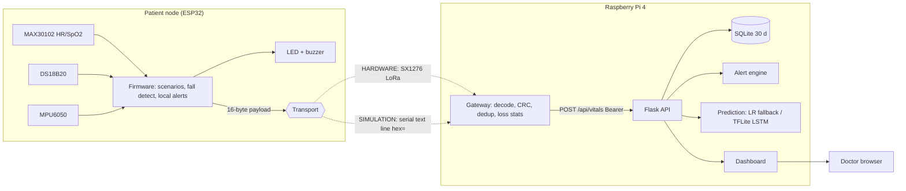

# Architecture

Layers (report): L1 Physical, L2 Acquisition (node), L3 Network (LoRa), L4 Supervision (dashboard), L5 Diagnosis/Prediction/Control (alerts, prediction, local buzzer/LED).

## 16-byte packet v1 (big-endian)
| Off | Len | Type | Field | Unit / scale | Valid |
|---|---|---|---|---|---|
| 0 | 1 | u8 | version | – | 1 |
| 1 | 2 | u16 | patient number | -> `P%03d` | 1..999 |
| 3 | 2 | u16 | seq | wraps 65536 | 0..65535 |
| 5 | 1 | u8 | HR | bpm | 20..250 (0 if fault) |
| 6 | 1 | u8 | SpO2 | % | 50..100 (0 if fault) |
| 7 | 2 | i16 | temperature | 0.01 °C | 2000..4500 (-32768 if fault) |
| 9 | 1 | u8 | flags | b0 fall, b1 synthetic, b2 HR/SpO2 fault, b3 temp fault, b4 IMU fault | b5-7 = 0 |
| 10 | 4 | u32 | uptime s | node has no RTC; gateway stamps `ts` on reception | – |
| 14 | 2 | u16 | CRC-16/CCITT-FALSE | bytes 0..13 | – |

All required fields fit in 16 bytes, so no field was dropped. Limitation: arrival time is the gateway's clock, not the sensing time. Debug JSON (`DBG {...}`) is separate and never transmitted over radio.

## Duplicates, loss, rate limit
* Gateway: duplicate = same (seq, uptime) within the last 64 per patient; loss = sequence gaps (mod 65536).
* API: duplicate = same (pid, seq, uptime) (unique index) -> `200 {"stored":false,"duplicate":true}`. Reboot-reused seq values are not duplicates because uptime differs.
* API throttle: 1 accepted write / `VITALS_MIN_INTERVAL_S` (30) per patient -> `429` + `Retry-After`.

## Radio parameters (project defaults, `gateway/radio.py::LoRaConfig`)
868.1 MHz (EU868; use 915 MHz in US/AU), BW 125 kHz, SF7 (range up to SF12), CR 4/5, sync word 0x12, radio CRC on, explicit header, 14 dBm. Respect local duty-cycle rules (a 16-byte packet at SF7 is roughly 50 ms on air; 60 s cycle is far below 1 % duty). Not verified over the air.
